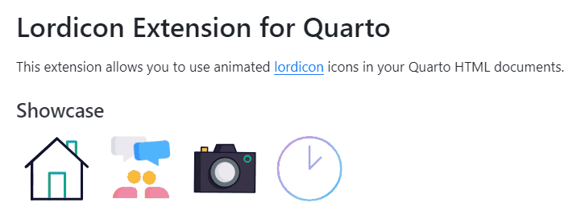

# Lordicon Extension for Quarto

[](https://github.com/jmgirard/lordicon/releases)
[](LICENSE)
[](https://quarto.org)

This extension embeds animated [Lordicon](https://lordicon.com) icons in Quarto HTML documents, including Reveal.js presentations. Icons can be pulled directly from the official CDN or loaded from local `.json` files, and their appearance can be customized on the fly — no need to edit the `.json` files.

## Examples

[](https://jmgirard.github.io/lordicon/)

Explore the live demo site for runnable examples and previews:

- [**Home**](https://jmgirard.github.io/lordicon/) — codes, colors, stroke, and accessibility
- [**CSS Styling**](https://jmgirard.github.io/lordicon/css_styling.html) — resize, position, and style icons
- [**Animations**](https://jmgirard.github.io/lordicon/animations.html) — triggers, states, delay, speed, and sequences
- [**Targets**](https://jmgirard.github.io/lordicon/target.html) — trigger an icon from another element

## Installing

```
$ quarto add jmgirard/lordicon
```

This will install the extension under the `_extensions` subdirectory. If you're using version control, you will want to check in this directory.

## Using

To embed an icon from the CDN, use the `` shortcode. For example:

```


```

Look up an icon's `code` by browsing [lordicon.com](https://lordicon.com/icons), clicking on an icon and choosing Export > Embed and clicking the code to copy it.

---

To embed an icon from a local .json file, use the `` shortcode. For example:

```


```

Download an icon's .json file by browsing [lordicon.com](https://lordicon.com/icons), clicking on an icon, and choosing Export > Lottie > Raw.

---

## Customizing

Both shortcodes forward any `key=value` pairs directly to the underlying
[`<lord-icon>` element](https://lordicon.com/docs/web), so you can use the full
element API without the extension needing to know each option:

| Argument   | Description                                                                 |
|------------|-----------------------------------------------------------------------------|
| `colors`   | Recolor the icon, e.g. `colors=primary:gold,secondary:#ee66aa`.             |
| `stroke`   | Line thickness: `light`, `regular`, or `bold` (supported icons).           |
| `trigger`  | Animation trigger: `in`, `click`, `hover`, `loop`, `loop-on-hover`, `morph`, `boomerang`, `sequence`. |
| `state`    | A named animation state exported with the icon (e.g. `state=morph-open`).   |
| `target`   | CSS selector of an ancestor element that fires the trigger (see Targets).    |
| `delay`    | Milliseconds to wait between loops (with `trigger=loop`).                    |
| `speed`    | Playback speed multiplier (e.g. `speed=2`).                                  |
| `loading`  | Defer loading: `lazy` (when scrolled into view), `interaction` (first user action), or `delay` (paired with `loading-delay=MS`). |
| `class`    | CSS class(es) to apply for styling.                                         |
| `style`    | Inline CSS, e.g. `style=width:50px;height:50px;`.                            |
| `label`    | Accessible label (see below).                                               |

Any other attribute the element supports can be passed the same way.

### Accessibility

By default icons are treated as decorative and marked `aria-hidden="true"` so
screen readers skip them. If an icon conveys meaning, give it a `label` and it
will be exposed with `role="img"` and that label instead:

```

```

## Note

In order for the icons to appear properly in your RStudio Viewer pane, you need to update to RStudio version 2022.12.0+353 or newer. You can still use older versions of RStudio, but to view your icons you will need to view the rendered HTML files in an external browser.
